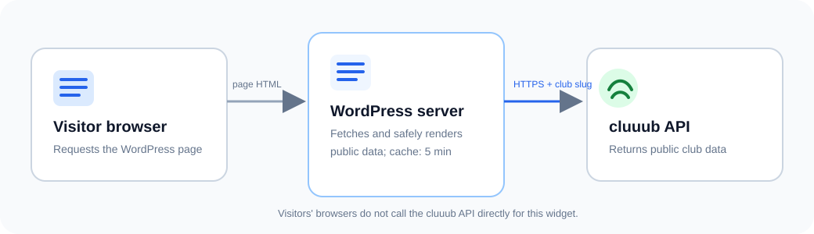

# cluuub <sub>[Setup](docs/WORDPRESS-SETUP.md) · [Docs · 14 languages](https://cluuub.app/developer) · [Releases](https://github.com/duphub42/cluuub-wordpress/releases)</sub> 

### Publish your club information on your WordPress website

**cluuub Embed** connects your website to your club’s approved public information in cluuub. Add content with a Gutenberg block or shortcode, without HTML skills or manually maintaining course details.

<p align="center">
  
</p>

> **Illustration:** This custom graphic uses sample content. It is a product mockup, not a screenshot of a real WordPress installation.

**Documentation:** [WordPress setup guide](docs/WORDPRESS-SETUP.md) · [cluuub developer documentation](https://cluuub.app/developer) · Available in **14 languages**; use the language selector on the site.

[Product scope](docs/PRODUCT-SCOPE.md) · [API contract](docs/API-CONTRACT.md) · [Security and privacy](docs/SECURITY.md)

## Features

- **Gutenberg block:** Set the club slug, content type, item limit, and search filter in the editor.
- **Shortcode:** Add content in the classic editor and compatible page builders.
- **Five public content types:** Sports activities, coaches, venues, board contacts, and sponsors.
- **Server-side requests:** WordPress fetches the public cluuub API. Visitors’ browsers do not connect directly to cluuub to display the widget.
- **Short cache:** Responses are cached in WordPress for five minutes.
- **Responsive cards:** The layout adapts to narrow and wide screens.

## Installation

1. Download the latest installable ZIP from [GitHub Releases](https://github.com/duphub42/cluuub-wordpress/releases/latest). If no release is available yet, use **Code → Download ZIP** as a preview build.
2. In WordPress, open **Plugins → Add New Plugin → Upload Plugin** and select the ZIP file.
3. Activate **cluuub Embed**.
4. Open **Settings → cluuub Embed**. The default origin, `https://cluuub.app`, is already configured. Change it only if your club uses another cluuub environment.
5. Add the **cluuub Embed** block or a shortcode to a page.

<p align="center">
  
</p>

## Use the Gutenberg block

Search for **cluuub Embed** in the block editor and configure:

- **Club slug:** the public club identifier from the cluuub URL, for example `sample-club`;
- **Content:** `angebote`, `trainer`, `hallen`, `vorstand`, or `sponsoren`;
- **Maximum items:** 1–50;
- **Search filter:** an optional term, for example `children`.

The editor shows a settings preview. Current club data is fetched server-side when the published page is rendered.

### Find your club slug

Use the short public club identifier, not the full URL. Ask your club administrator if you are unsure which identifier is published for your club. The example `sample-club` below is illustrative.

## Use a shortcode

Add this shortcode in a Shortcode block or a compatible page-builder element:

```text
[cluuub club="sample-club" type="angebote"]
```

Optional attributes:

```text
[cluuub club="sample-club" type="trainer" limit="8" filter="youth"]
```

| Attribute | Values | Default |
|---|---|---|
| `club` | Lowercase letters, numbers, and hyphens | Required |
| `type` | `angebote`, `trainer`, `hallen`, `vorstand`, `sponsoren` | `angebote` |
| `limit` | 1–50 | 12 |
| `filter` | Any text; optional | Empty |

The `type` values and shortcode names are identical for the Gutenberg block and shortcode:

```text
[cluuub club="sample-club" type="angebote"]
[cluuub club="sample-club" type="trainer"]
[cluuub club="sample-club" type="hallen"]
[cluuub club="sample-club" type="vorstand"]
[cluuub club="sample-club" type="sponsoren"]
```

## Compatibility and styling

The plugin declares **WordPress 6.4 or later** and **PHP 7.4 or later**. Automated checks cover static safety rules and isolated PHP behavior. A full compatibility matrix against hosted WordPress versions, themes, and third-party page builders has not yet been completed. The shortcode is available as a fallback where a builder does not expose Gutenberg blocks.

The widget uses CSS classes you can override in your theme’s custom CSS. For example:

```css
.cluuub-widget h2 { color: #163a70; }
.cluuub-widget .cluuub-card {
  border-radius: 1rem;
  box-shadow: 0 0.25rem 1rem rgb(15 23 42 / 10%);
}
```

Theme CSS can affect the widget. Check the published page on desktop and mobile after changing styles.

## Privacy at a glance

On a cache miss, the **WordPress server** sends an HTTPS request to the configured cluuub environment. cluuub receives the server’s network address and the requested club slug. WordPress caches the response for up to five minutes. A visitor’s browser does not call the cluuub API directly for this widget.

The plugin fetches public showcase data only. It does not send WordPress member data to cluuub and this version does not include forms that submit personal data. Site owners should describe this server-to-server request in their privacy notice. See [Security and privacy](docs/SECURITY.md) for details.

<p align="center">
  
</p>

## Current scope

News are not available as a widget yet. The API contract must first ensure that news are scoped to the requested club. Trial-session and booking forms, member synchronization, and analytics tracking are also outside this plugin version.

## Troubleshooting

| Symptom | What to check |
|---|---|
| The block is empty | Confirm the club slug and content type. Check that the club has published visible entries of that type. |
| A club page shows no data | Confirm the public showcase is available in cluuub and that the WordPress server can make outbound HTTPS requests. |
| Recent changes are missing | The response can remain cached for up to five minutes. Reload after the cache period. |
| The widget looks different from the preview | Theme CSS can override widget styles. Check custom CSS and the page on mobile. |
| An error appears only in the editor/admin | Review the slug and configured HTTPS origin. Public visitors receive a quiet empty state for remote errors. |

For setup help, use the [WordPress setup guide](docs/WORDPRESS-SETUP.md). For general cluuub API documentation, use the [14-language developer documentation](https://cluuub.app/developer).

## Development and tests

Requirements: Node.js for static checks; PHP 7.4 or later for PHP syntax and smoke tests.

```bash
npm test
php -l cluuub.php
php tests/php-smoke.php
```

The GitHub Actions workflow runs static checks, PHP syntax checks, and the PHP smoke test on pushes and pull requests.

See [CONTRIBUTING.md](CONTRIBUTING.md) for contribution guidelines and [SECURITY.md](SECURITY.md) for responsible vulnerability reporting. Release ZIP packages are prepared automatically when a GitHub Release is published.

## License

GPL-2.0-or-later. See [LICENSE](LICENSE).
