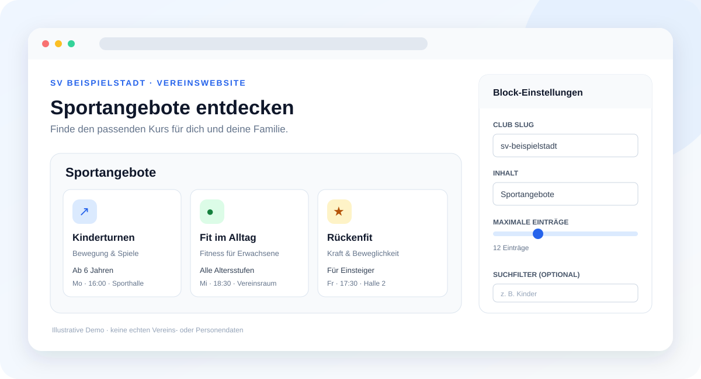
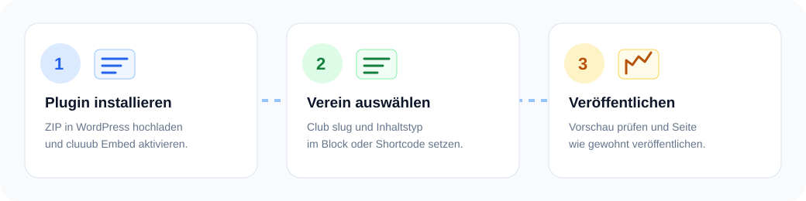

# cluuub

<p align="center">
  
</p>

### Publish your club information on your WordPress website

**cluuub Embed** connects your website to your club’s approved public information in cluuub. Add content with a Gutenberg block or shortcode, without HTML skills or manually maintaining course details.

<p align="center">
  
</p>

> **Illustration:** This custom graphic uses sample content. It is a product mockup, not a screenshot of a real WordPress installation.

**Documentation:** [Developer documentation on cluuub.app](https://cluuub.app/developer) · Available in **14 languages**; use the language selector on the site.

[Product scope](docs/PRODUCT-SCOPE.md) · [API contract](docs/API-CONTRACT.md) · [Security and privacy](docs/SECURITY.md)

## Features

- **Gutenberg block:** Set the club slug, content type, item limit, and search filter in the editor.
- **Shortcode:** Add content in the classic editor and compatible page builders.
- **Five public content types:** Sports activities, coaches, venues, board contacts, and sponsors.
- **Server-side requests:** WordPress fetches the public cluuub API. Visitors’ browsers do not connect directly to cluuub to display the widget.
- **Short cache:** Responses are cached in WordPress for five minutes.
- **Responsive cards:** The layout adapts to narrow and wide screens.

## Installation

1. Download the ZIP from this repository using **Code → Download ZIP**.
2. In WordPress, open **Plugins → Add New Plugin → Upload Plugin** and select the ZIP file.
3. Activate **cluuub Embed**.
4. Open **Settings → cluuub Embed**. The default origin, `https://cluuub.app`, is already configured. Change it only if your club uses another cluuub environment.
5. Add the **cluuub Embed** block or a shortcode to a page.

<p align="center">
  
</p>

## Use the Gutenberg block

Search for **cluuub Embed** in the block editor and configure:

- **Club slug:** the public club identifier from the cluuub URL, for example `sv-halle`;
- **Content:** `angebote`, `trainer`, `hallen`, `vorstand`, or `sponsoren`;
- **Maximum items:** 1–50;
- **Search filter:** an optional term, for example `children`.

The editor shows a settings preview. Current club data is fetched server-side when the published page is rendered.

## Use a shortcode

Add this shortcode in a Shortcode block or a compatible page-builder element:

```text
[cluuub club="sv-halle" type="angebote"]
```

Optional attributes:

```text
[cluuub club="sv-halle" type="trainer" limit="8" filter="youth"]
```

| Attribute | Values | Default |
|---|---|---|
| `club` | Lowercase letters, numbers, and hyphens | Required |
| `type` | `angebote`, `trainer`, `hallen`, `vorstand`, `sponsoren` | `angebote` |
| `limit` | 1–50 | 12 |
| `filter` | Any text; optional | Empty |

## Privacy at a glance

On a cache miss, the **WordPress server** sends an HTTPS request to the configured cluuub environment. cluuub receives the server’s network address and the requested club slug. WordPress caches the response for up to five minutes. A visitor’s browser does not call the cluuub API directly for this widget.

The plugin fetches public showcase data only. It does not send WordPress member data to cluuub and this version does not include forms that submit personal data. Site owners should describe this server-to-server request in their privacy notice. See [Security and privacy](docs/SECURITY.md) for details.

## Current scope

News are not available as a widget yet. The API contract must first ensure that news are scoped to the requested club. Trial-session and booking forms, member synchronization, and analytics tracking are also outside this plugin version.

## Development and tests

Requirements: Node.js for static checks; PHP 7.4 or later for PHP syntax and smoke tests.

```bash
npm test
php -l cluuub.php
php tests/php-smoke.php
```

The GitHub Actions workflow runs static checks, PHP syntax checks, and the PHP smoke test on pushes and pull requests.

## License

GPL-2.0-or-later. See [LICENSE](LICENSE).
